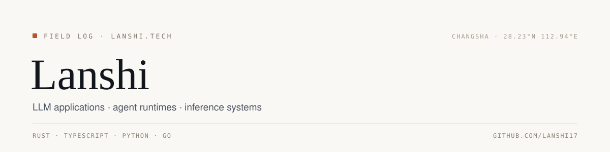

<picture>
  <source media="(prefers-color-scheme: dark)" srcset="assets/banner-dark.svg">
  <source media="(prefers-color-scheme: light)" srcset="assets/banner-light.svg">
  
</picture>

CS graduate student at Central South University and Hunan Agricultural University. Open to full-time and internship roles — [yhvguk@foxmail.com](mailto:yhvguk@foxmail.com).

## Now

<!-- NOW:START -->
- **[LinguaSeeker](https://github.com/lanshi17/LinguaSeeker)** — 用于辅助研究人员基于ACMG/AMP指南自动化基因变异分类。平台通过LLM解析上传的PDF文献（支持多语种），提取证据，集成ClinVar验证，并优先以HTML界面输出结果，以提升变异评级的准确性和效率。 `Python`
- **[lanshi17_js](https://github.com/lanshi17/lanshi17_js)** — No description yet. `JavaScript`
- **[PACE-RAG](https://github.com/lanshi17/PACE-RAG)** — Condition-constrained evidence retrieval and verifiable generation for prenatal ultrasound. `Python`
<!-- NOW:END -->

## Selected work

<!-- SELECTED:START -->
| Project | Stack | What it does |
| :-- | :-- | :-- |
| [dsh-booth](https://github.com/lanshi17/dsh-booth) | Rust · Agent · LLM | Terminal console for a running dsh agent — send a ticket, watch the executor, pick commands from a palette. |
| [wechat-rs](https://github.com/lanshi17/wechat-rs) | Rust · Axum · Docker | 🚀 高性能微信公众号后端服务 — Rust + Axum 构建，一键部署，支持 PostgreSQL/Redis 存储，内置管理后台 |
| [zhishi](https://github.com/lanshi17/zhishi) | TypeScript · Agent · Bun | 知食 ZhīShí — WeChat calorie-tracking assistant: agent pipeline + LightRAG + PostgreSQL, Bun/TypeScript. |
| [esengine/DeepSeek-Reasonix](https://github.com/esengine/DeepSeek-Reasonix) | Go · Agent · Agent Framework | A reliable coding agent for complex software engineering tasks. |
| [CherryHQ/cherry-studio](https://github.com/CherryHQ/cherry-studio) | TypeScript · AI Agents · Agent Workspace | Your AI workspace for models, agents, and productivity. |
<!-- SELECTED:END -->

## Writing

Notes on LLMs, systems, and the occasional detour — 52 posts and counting. Latest:

<!-- BLOG-POST-LIST:START -->
- [Stanford CS336 总览与学习路线图](https://blog.lanshi.dev/studynotes/cs336/00-overview/) — 2026-10-29
- [从头构建语言模型与分词器](https://blog.lanshi.dev/studynotes/cs336/01-tokenization/) — 2026-10-29
- [PyTorch、Einops 与资源核算](https://blog.lanshi.dev/studynotes/cs336/02-pytorch-resource-accounting/) — 2026-10-29
- [现代 Transformer 架构详解](https://blog.lanshi.dev/studynotes/cs336/03-architectures/) — 2026-10-29
- [注意力替代方案与 MoE](https://blog.lanshi.dev/studynotes/cs336/04-attention-moe/) — 2026-10-29

<!-- BLOG-POST-LIST:END -->

[All posts](https://blog.lanshi.dev/archives) · [RSS](https://blog.lanshi.dev/rss.xml)

## GitHub

  <picture>
    <source media="(prefers-color-scheme: dark)" srcset="https://github-readme-stats-gamma-nine-75.vercel.app/api?username=lanshi17&show_icons=true&include_all_commits=true&hide_rank=true&hide_border=true&custom_title=Lanshi%27s%20GitHub%20Stats&theme=github_dark&bg_color=0B0F14&title_color=E07A5F&icon_color=E07A5F&text_color=C9D1D9">
    
  </picture>
  <picture>
    <source media="(prefers-color-scheme: dark)" srcset="https://github-readme-stats-gamma-nine-75.vercel.app/api/top-langs/?username=lanshi17&layout=compact&langs_count=6&hide_border=true&theme=github_dark&bg_color=0B0F14&title_color=E07A5F&text_color=C9D1D9">
    
  </picture>

## Contact

- **Email** — [yhvguk@foxmail.com](mailto:yhvguk@foxmail.com)
- **Blog** — [blog.lanshi.dev](https://blog.lanshi.dev)
- **Resume** — [blog.lanshi.dev/resume](https://blog.lanshi.dev/resume/)
- **LLM API** — [linxi.chat](https://linxi.chat)
- **WeChat** — `lanshi0317`
